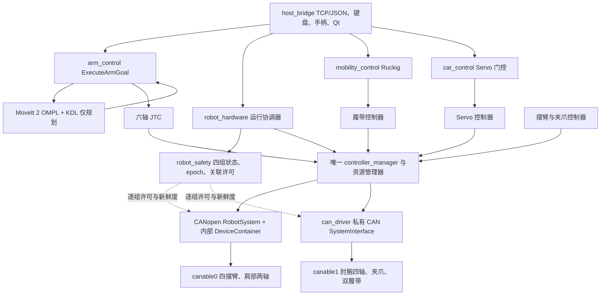

# ROS2 项目架构与数据流

更新：2026-10-26。下图对应当前活动 ROS2 包。



JTC 与 Servo 由运行协调器互斥激活。`init → Armed → Running` 为显式操作；命令 epoch 改变后只接受新输入。CANopen 与私有 CAN 的关节所有权互不重叠。

```mermaid
flowchart LR
    DEV[硬件或 Fortress 传感器] --> RAW[原始 /joint_states]
    RAW --> CHECK[运行安全与执行就绪检查]
    RAW --> FILTER[robot_bringup 有限位置过滤]
    FILTER --> MODEL[/robot_model/joint_states]
    MODEL --> RSP[robot_state_publisher]
    RSP --> TF[TF 与 MoveIt 模型]
    CAM[RealSense / Orbbec / USB] --> RGB[Image、Depth、CameraInfo]
    RGB --> VISION[vision_pkg 检测、投影、全景、H265]
    RGB --> ARUCO[aruco_ros]
    ARUCO --> CAL[easy_handeye2 与 eye_in_hand]
    CAL --> EXT[保存标定与静态外参]
    RGB --> VIDEO[host_bridge 图像转 RTSP]
    VIDEO --> MTX[MediaMTX / 上位机视频]
```

TF 的过滤分支只负责模型显示。无效原始反馈仍进入安全判定，不能由显示正常推断设备就绪。标定入口和保存后发布入口须避免同时发布同一外参。

[硬件拓扑](01_系统概述与硬件拓扑.md) · [设计决策](03_架构设计与决策过程.md) · [启动与验证](../README.md)
