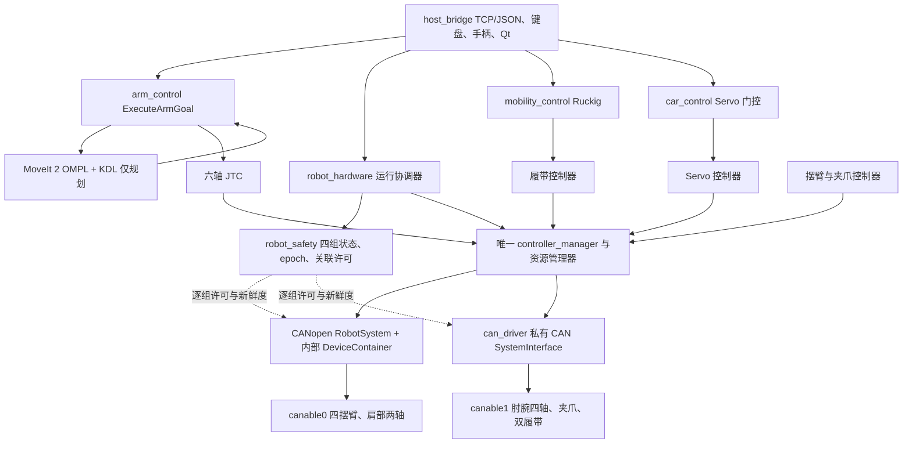

# ROS2 项目架构与数据流

更新：2026-11-04。下图对应当前活动 ROS2 包。



JTC 与 Servo 由运行协调器互斥激活。`init` 配置并核验，`enable` 到 Armed，`resume` 到 Running；命令 epoch 改变后只接受新输入。CANopen 与私有 CAN 的关节所有权互不重叠。此图为实机控制链；Mock 使用模拟硬件组件，Fortress 使用 Gazebo 硬件插件，并由 Gazebo 持有唯一控制管理器。

```mermaid
flowchart LR
    DEV[硬件或 Fortress 关节反馈] --> HW[SystemInterface 读取与新鲜度检查]
    HW --> SAFE[robot_safety 硬件许可与故障判定]
    HW --> JSB[joint_state_broadcaster]
    JSB --> RAW[原始 /joint_states]
    RAW --> CHECK[执行入口与只读就绪检查]
    RAW --> FILTER[robot_bringup 有限位置过滤]
    FILTER --> MODEL[/robot_model/joint_states]
    MODEL --> RSP[robot_state_publisher]
    RSP --> TF[TF 与 MoveIt 模型]
    CAM[RealSense / Orbbec / USB] --> RGB[Image、Depth、CameraInfo]
    RGB --> VISION[vision_pkg 检测、投影、全景、H265]
    RGB --> ARUCO[aruco_ros]
    ARUCO --> CAL[easy_handeye2 与 eye_in_hand]
    CAL --> EXT[保存标定与静态外参]
    RGB --> VIDEO[host_bridge 图像转 RTSP]
    VIDEO --> MTX[MediaMTX / 上位机视频]
```

TF 的过滤分支只负责模型显示。无效原始反馈仍进入安全判定，不能由显示正常推断设备就绪。标定入口和保存后发布入口须避免同时发布同一外参。

整车入口默认关闭相机、视觉、上位机桥、CO₂ 和热成像，图中的外围链路按需启用；手眼标定和 USB 相机使用各自独立入口。自动标定走点由 `eye_in_hand/auto_sample.py` 调用项目 `ExecuteArmGoal`，上游 `easy_handeye2` 负责采样、求解及保存，不使用其通用运动辅助节点。

## 子仓库职责与维护边界

当前 6 个活动子仓库按以下职责使用，具体版本由主仓库 gitlink 锁定：

| 子仓库 | 职责 | 维护方式 |
| --- | --- | --- |
| `can_driver`、`ros2_canopen` | 私有 CAN 与 CANopen 控制后端 | 项目自主维护，可按整车控制、接口和安全需求修改并发布匹配版本 |
| `realsense-ros`、`OrbbecSDK_ROS2` | 相机驱动依赖 | 优先使用上游原版，尽量不修改源码 |
| `aruco_ros`、`easy_handeye2` | 标记检测与手眼标定依赖 | 优先使用上游原版，尽量不修改源码 |

第三方依赖的项目适配优先放在 `vision_pkg`、`eye_in_hand` 等项目包的配置、启动文件或接口封装中，也可采用上游已发布的修复。只有确认存在阻塞当前实际使用功能的问题，且无法通过项目侧适配或上游版本解决时，才考虑对依赖做最小修改，并记录必要性、影响范围和可复现的发布来源。依赖中未启用的可选功能不作为扩大修改范围的理由。

子仓库的获取、提交及匹配版本发布流程见 [子模块工作流](git_submodule_workflow.md)。

[硬件拓扑](01_系统概述与硬件拓扑.md) · [设计决策](03_架构设计与决策过程.md) · [启动与验证](../README.md)
