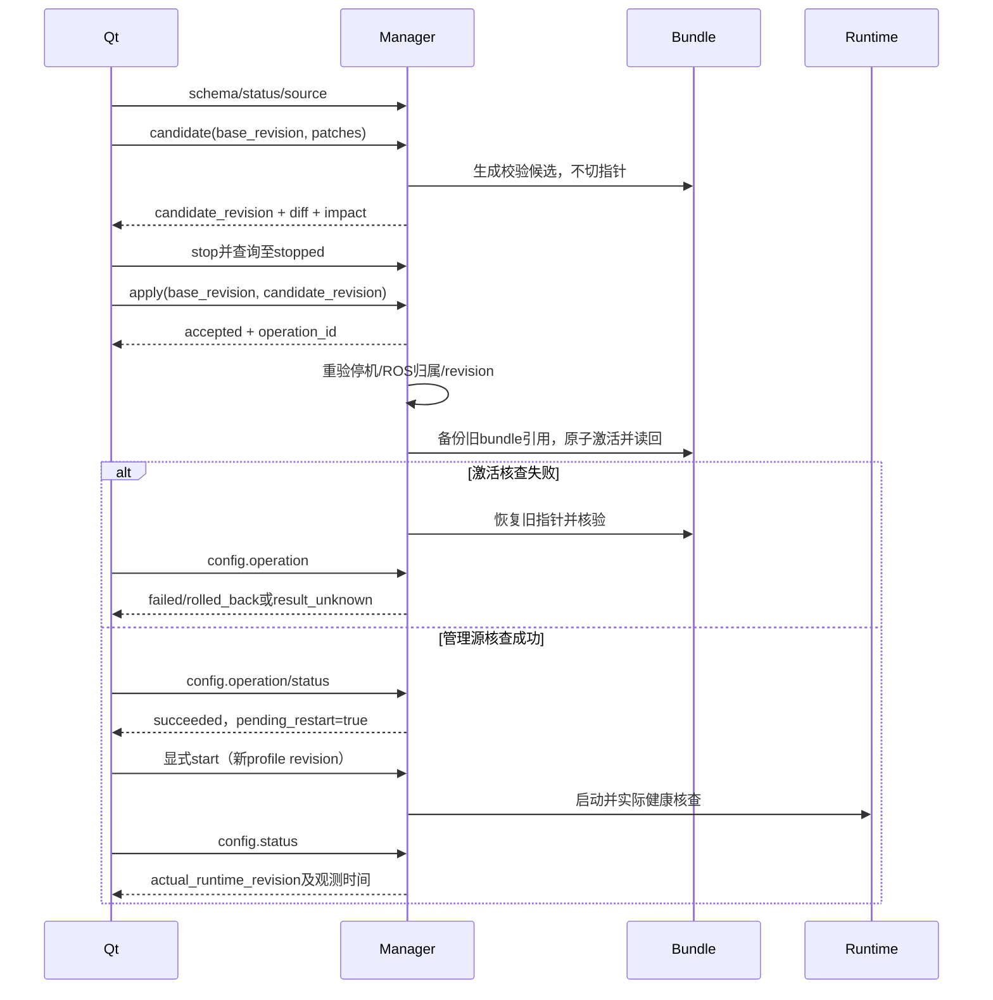

# 配置事务 v1 / 阶段 B 增量交接

> 2026-11-08 归档：本页保存 Qt 对接阶段的协议、要求或验证快照；归档不代表 Qt 联调、实机验收或发布已完成。当前 ROS2 缺口统一见 [清单 36](../../36_ROS2迁移剩余事项清单.md)，运行部署见 [robot_manager](../../../robot_manager/README.md)。本文历史命令中的源码路径仍相对仓库根目录。

构建系列robot24-p0-config-2。下位机已实现，Qt待接，双方共同验收。管理TCP9091、共享令牌、version=1、64KiB NDJSON、原启停方法全部保留；hello.capabilities新增config.schema/status/source/candidate/preview/apply/rollback/operation/audit，schema.capability=config_transactions_v1。没有改变旧管理消息的必需字段。部署manager.json显式设置enable_config_transactions=true后才导入配置bundle并公布这些能力；默认false可独立发布阶段A，配置维护不作为P0启动前提。关闭时配置请求返回CAPABILITY_DISABLED。

## 覆盖范围和权威来源

首批可编辑字段只覆盖管理档案的startup_timeout（数值1..180，秒，Manager.work单调启动健康预算）及video_required（bool，为true要求既有video=true，Backend.required模块健康策略）。video_required变化由服务器同步生成required_modules/optional_modules。video设备、相机源、方向/比例/零位/限位、标定、ROS运行参数和设备非易失写入均不可编辑；不编造设备限值。本范围内没有方向/标定变化，也没有普通保存触发设备写入的路径。

所有应用必须先通过既有管理stop达到stopped，无受管资源、无进行中的start/stop且无恢复待处理；独立worker再次做部署/现有ROS归属预检，激活前再查停机与revision。应用不自动启动、使能或resume，因此运动授权在停栈断开时已经失效。外部ROS栈存在会被既有preflight拒绝。无设备fixture专门注入preflight，不计为真实归属证明。

## 字段约束（等效schema）

沿管理v1 `{version:1,token,request_id,method,params}`，响应沿原ok/result或ok=false/error格式。所有revision是不透明64位小写SHA256字符串，客户端不得数值比较、拼路径或假设它等于初始部署profile.config_revision。profile.config_revision仍是start所需字段，始终从profiles读取。

| method | params | result |
| --- | --- | --- |
| config.schema | {} | schema_version=1、capability、scope、fields（类型/单位/范围/依赖/可编辑/维护/停组/重启/来源）、readonly_fields、体积上限 |
| config.status | {} | source_revision、source_summary、candidate_revisions、candidate_summaries、effective_management_revision、actual_runtime_revision、runtime_observed_at、pending_restart、applying、scope、device_nvm_written=false |
| config.source | profile_id:string，revision可选默认当前 | revision、summary、完整单profile对象及其config_revision |
| config.candidate | base_revision、patches数组（1..64） | candidate_revision、base_revision、summary、diff、affected_groups=[all]、maintenance_required、pending_restart、device_nvm_written |
| config.preview | candidate_revision | 已保存候选的差异及影响信息 |
| config.apply | base_revision、candidate_revision | 异步配置operation对象 |
| config.rollback | base_revision、target_revision（历史可用bundle） | 独立异步配置operation对象 |
| config.operation | operation_id | 持久配置operation，不与旧管理operation混用 |
| config.audit | cursor非负整数默认0、limit整数1..50默认50 | items、next_cursor，超界CURSOR |

patch对象严格为 `{profile_id:string,field:"startup_timeout"|"video_required",value:number|bool}`，不接受额外键、重复profile/field、NaN、未知字段或路径。候选保存只验证并生成不可变候选bundle，绝不隐式激活。候选与当前source的base_revision必须一致；apply再次检查，冲突REVISION_CONFLICT，Qt必须重新加载和确认差异。

配置operation字段：operation_id/method/base_revision/target_revision字符串；state为accepted/running/succeeded/failed/result_unknown；phase为validate/activate/complete/rolled_back/reconcile；summary、affected_groups、maintenance_required描述影响范围；error为null、错误对象或重启标识字符串；pending_restart布尔；verification为null或manager_source_readback；created_at/updated_at为Unix秒；完成时可附effective_management_revision/actual_runtime_revision/rollback_revision。

配置方法请求ID在独立配置命名空间内持久幂等，绑定method+params规范JSON摘要（Qt建议统一前缀config-UUID避免混淆）。相同ID同参数返回原候选或操作，异参数REQUEST_CONFLICT。事务只允许一个worker，BUSY时不排队；start/stop/preflight与激活互斥，status/snapshot查询不等待预检。配置journal最多512个写请求，满则CONFIG_CACHE_FULL，必须离线归档；不自动删除幂等记录。候选与历史bundle也由部署者停机归档。

## 应用、生效和恢复

启动时将部署config_root内JSON档案导入state_dir/configuration/bundles；原部署目录只读，baseline/video_config仍按既有config_root范围校验。每个bundle包含所有profile文件和SHA256清单；候选在stage目录逐文件写入/fsync，再将完整目录rename为不可变bundle。激活只原子替换active.json一个指针，旧bundle即备份。多文件中断留下的stage不可见；重启只读取完整bundle和active指针，不逐个覆盖活动文件。不能手工修改bundle：start会核验摘要。

事务顺序：持久accepted→running/validate→实际部署及现存ROS预检→复查维护和base→持久activate意图→切指针→全部profile摘要及管理源读回核验→succeeded/complete。任何可捕获失败尝试将指针回滚base并核验，结果failed/rolled_back、rollback_revision；回滚无法确认则result_unknown/reconcile/ROLLBACK_UNKNOWN。显式rollback使用相同停机、预检和读回流程，绝不隐式写设备。

崩溃在accepted/running中重启：旧操作result_unknown/MANAGER_RESTART，不重放。active指针可能是旧或新revision，config.status/source给出实际可读源；操作查询不猜测崩溃前物理状态。先确认管理stop，再显式rollback或使用新base保存/应用候选。初始导入尚无active指针时，即使中断也只会重新导入或复用完整bundle。

`effective_management_revision`表示管理器从活动指针实际读取到的配置；应用成功的verification=manager_source_readback。停止状态actual_runtime_revision=null、pending_restart=true。之后用户显式start，真实健康结果ready/degraded且观测5秒内、运行profile与当前源逐字段相同时，才返回actual_runtime_revision=当前bundle revision、pending_restart=false；该值只证明管理启动策略已被本次启动消费，不证明设备或ROS任意参数已改变。当前范围无在线ROS重载。单纯文件写成功不会显示“设备配置已生效”。

## 帧预算和错误

配置请求params编码最多49152字节，patches最多64；超限REQUEST_TOO_LARGE/BAD_REQUEST，拒绝整笔，不分段隐式应用。source一次一个profile，大于49152字节返回RESPONSE_TOO_LARGE，要求离线维护；不提供部分profile内容。audit按50项分页。其他响应仍由原管理层64KiB预算返回RESPONSE_TOO_LARGE，客户端不得将该响应视作写请求未执行：用相同request_id或operation_id查询。

新增错误：CONFIG_FIELD、CONFIG_VALIDATION、REVISION_CONFLICT、CONFIG_DIGEST、MAINTENANCE_REQUIRED、CONFIG_PREFLIGHT、CONFIG_EFFECTIVE_MISMATCH、CONFIG_CACHE_FULL、REQUEST_TOO_LARGE、ROLLBACK_UNKNOWN；沿用AUTH/VERSION/BAD_REQUEST/REVISION/PROFILE/BUSY/NOT_FOUND/CURSOR/REQUEST_CONFLICT。错误是机器状态来源；不解析日志文字。

## Qt接入与fixture

Qt管理服务层新增上述方法及候选/源/实际生效revision状态仓库；编辑器只显示schema可编辑字段，带单位和范围，保留不可编辑源信息。保存前展示差异/受影响组/需停机重启，保存后仍显示“候选”；apply/rollback保存operation_id并轮询config.operation。未知结果先查status/source，不能凭文件或accepted ACK显示已生效，也不自动重试新ID。启动后从profiles取新profile.config_revision。维护页面不执行远程文件写入。

```bash
PYTHONDONTWRITEBYTECODE=1 python3 robot_manager/config_fixture.py
# 可供Qt连接的回环mock；令牌是固定、公开、仅fixture使用，不得用于部署
PYTHONDONTWRITEBYTECODE=1 python3 robot_manager/config_fixture.py --serve --port 19093
PYTHONDONTWRITEBYTECODE=1 python3 -m unittest discover -s robot_manager/tests -p test_config_transactions.py -v
```

fixture提供schema、保存不生效、revision冲突、成功应用、同ID查询、切换后失败回滚、显式rollback及审计的完整请求/响应NDJSON。后端无ROS/CAN/相机，不代表真实设备验收。


